<div align="center">
  <br />
  <samp>
    <h2>E F E &nbsp; A R T U N</h2>
  </samp>
  
</div>

<br />

```toml
# 0x01 // profile.toml
[core]
handle = "efeartn"
focus  = ["Systems Engineering", "Cybersecurity", "Automation"]
work   = "Cross-platform utilities, DNS & protocol analysis, lightweight CLI tools"
```

<br />

<div align="center">
  
  
  
  
  
  
  
  
  
</div>

<br />

<div align="center">
  
  <br />
  
</div>

<br />

<div align="center">
  
</div>
